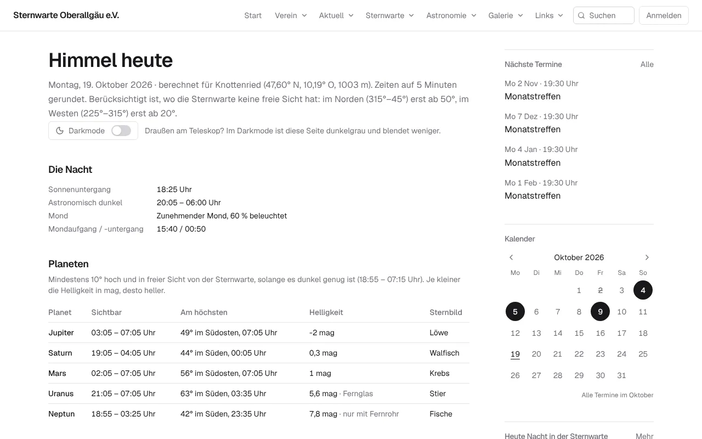
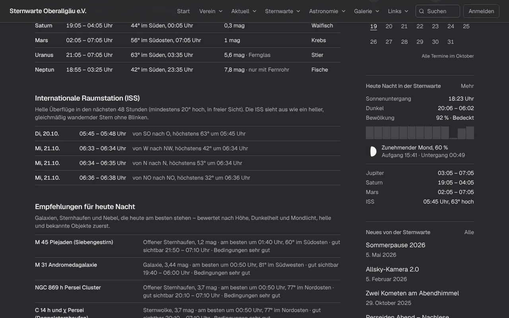
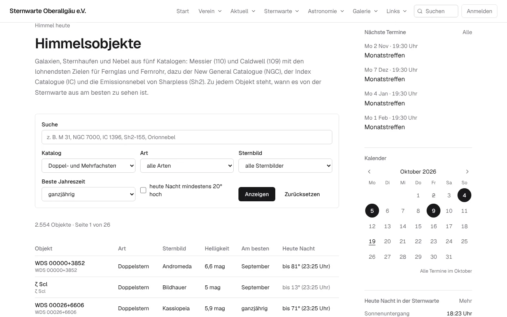
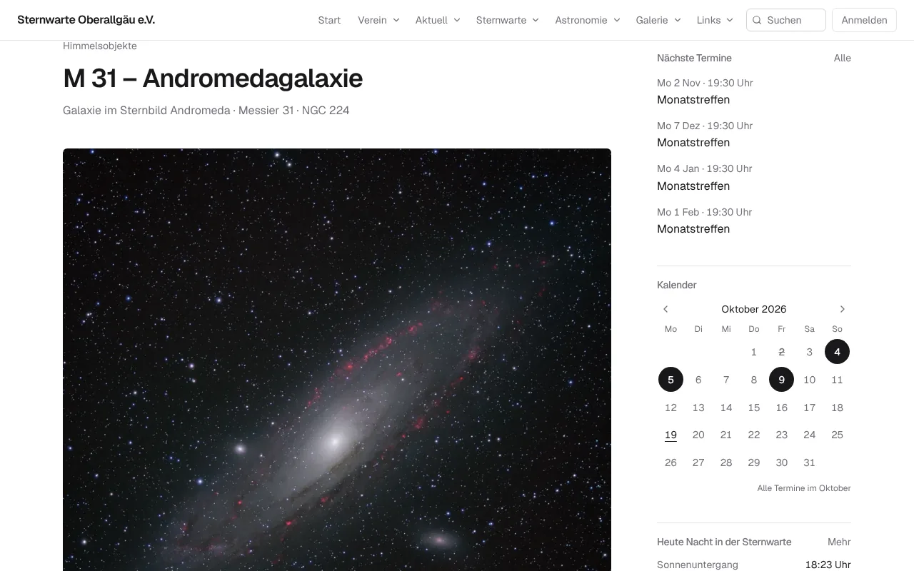
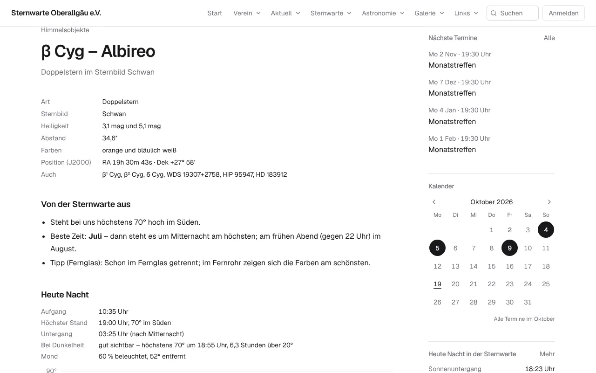

# Himmel heute und Himmelsobjekte

Diese Seiten sind für alle Besucher der Webseite da – ohne Anmeldung. Den **Beobachtungsplan** für einen Abend am
Fernrohr gibt es für Mitglieder: siehe [Mitgliederbereich → Beobachtungsplan](mitglieder.md#beobachtungsplan).
Die Technik dahinter steht in [Betrieb → Himmel](../betrieb/himmel.md).

**Inhalt**

1. [Himmel heute](#1-himmel-heute)
2. [Darkmode für draußen am Teleskop](#2-darkmode-für-draußen-am-teleskop)
3. [Himmelsobjekte suchen](#3-himmelsobjekte-suchen)
4. [Eine Objektseite lesen](#4-eine-objektseite-lesen)
5. [Doppel- und Mehrfachsterne](#5-doppel--und-mehrfachsterne)
6. [Kleines Himmels-Wörterbuch](#6-kleines-himmels-wörterbuch)

---

## 1. Himmel heute

Rechts in der Seitenleiste bei **„Heute Nacht in der Sternwarte“** auf **„Mehr“** klicken – oder direkt die Adresse
`/himmel/heute` öffnen.

Die Seite ist für die Sternwarte selbst berechnet – nicht für irgendeinen Ort in Deutschland. Sie weiß, wo Bäume und
Gelände die Sicht versperren (im Beispiel: im Norden erst ab 50° Höhe frei), und zeigt nur, was man von dort aus
wirklich sehen kann.

| Abschnitt | Was steht dort |
|---|---|
| **Die Nacht** | Sonnenuntergang, wann es richtig dunkel ist, Mondphase und wann der Mond auf- und untergeht |
| **Planeten** | welche Planeten wann zu sehen sind, wie hoch sie stehen und in welchem Sternbild |
| **Empfehlungen für heute Nacht** | Galaxien, Nebel, Sternhaufen und Doppelsterne, die heute gut stehen – ein Klick führt zur Objektseite, darunter der Link zu allen Objekten, die heute zu sehen sind |
| **Helle Satelliten** | Überflüge der rund 150 hellsten Satelliten heute Nacht – mindestens 20° hoch und von der Sonne beleuchtet |
| **Internationale Raumstation (ISS)** | helle Überflüge der nächsten Tage |
| **Die nächsten 30 Tage** | Ereignisse wie Vollmond, Neumond, Planeten in Opposition, Sternschnuppen-Ströme |

**Tipp:** Je **kleiner** die Zahl bei „Helligkeit“ (mag), desto **heller** ist ein Objekt. Jupiter mit −2 mag ist
sehr hell, Neptun mit 7,8 mag sieht man nur im Fernrohr. Mit bloßem Auge geht es unter dunklem Himmel bis etwa 6 mag.

## 2. Darkmode für draußen am Teleskop

Draußen in der Nacht gewöhnen sich die Augen langsam an die Dunkelheit – ein heller Bildschirm macht das in einer
Sekunde wieder zunichte. Deshalb hat die Seite **Himmel heute** oben einen Schalter **„Darkmode“**.

- Schalter anklicken → die Seite wird **dunkelgrau** mit gedämpfter Schrift.
- Die Webseite merkt sich die Wahl auf diesem Gerät. Beim nächsten Besuch von „Himmel heute“ ist der Darkmode
  wieder an.
- Der Darkmode gilt nur für diese Seite – der Rest der Webseite bleibt normal.
- Zusätzlich hilft: Helligkeit des Handys ganz herunterdrehen.

## 3. Himmelsobjekte suchen

Von „Himmel heute“ geht es zu den **Himmelsobjekten** (Adresse `/himmel/objekte`). Dort stehen rund 16 000
Galaxien, Nebel, Sternhaufen und Doppelsterne.

| Feld | Wozu |
|---|---|
| **Suche** | Name oder Nummer eintippen: `M 31`, `NGC 7000`, `IC 1396`, `Sh2-155`, `Orionnebel`, `Albireo`, `61 Cyg` |
| **Katalog** | Messier, Caldwell, NGC, IC, Sharpless oder **Doppel- und Mehrfachsterne** |
| **Art** | z. B. nur Galaxien, nur Kugelsternhaufen |
| **Sternbild** | nur Objekte in einem Sternbild |
| **Beste Jahreszeit** | in welchem Monat das Objekt am Abend am besten steht |
| **heute Nacht mindestens 20° hoch** | nur, was heute Nacht über Bäume und Dächer kommt |

Dann **„Anzeigen“**. Die Spalte **„Heute Nacht“** zeigt, wie hoch das Objekt heute höchstens steht und wann.
Grau geschrieben heißt: zu tief oder hinter den Bäumen. **„Zurücksetzen“** löscht alle Filter.

## 4. Eine Objektseite lesen

Ein Klick auf ein Objekt öffnet seine Seite.

- **Oben:** Name, Art, Sternbild und andere Namen (M 31 heißt auch NGC 224).
- **Bild:** ein Foto aus der Galerie des Vereins, wenn es eins gibt.
- **Steckbrief:** Helligkeit, Größe am Himmel, Position (J2000) und weitere Bezeichnungen.
- **Von der Sternwarte aus:** wie hoch es bei uns höchstens kommt, in welchem Monat es am besten steht, und ob ein
  Fernglas reicht oder ein Fernrohr nötig ist.
- **Heute Nacht:** Aufgang, höchster Stand, Untergang, wie lange es bei Dunkelheit gut zu sehen ist, wie weit der Mond
  entfernt steht – dazu eine Kurve der Höhe über die Nacht, in der die verdeckten Bereiche eingezeichnet sind.
- **Fotos aus dem Verein**, auf denen das Objekt zu sehen ist, und **Termine**, bei denen es eine Rolle spielt.

## 5. Doppel- und Mehrfachsterne

Im Fernrohr sieht man bei vielen Sternen, dass es eigentlich zwei oder mehr sind – oft in schönen Farben, etwa
Albireo im Schwan (orange und blau). Die Webseite kennt gut 2 500 solcher Sterne, die man von der Sternwarte aus
trennen kann.

Zusätzlich zur normalen Objektseite stehen dort:

| | |
|---|---|
| **Helligkeit** | die Helligkeit jedes einzelnen Sterns, z. B. „3,1 mag und 5,1 mag“ |
| **Abstand** | wie weit die Sterne auseinander stehen, in Bogensekunden (″). Ab etwa 5″ trennt sie ein kleines Fernrohr, ab 30″ oft schon ein Fernglas |
| **Farben** | die Farben der Sterne, soweit bekannt |
| **Tipp** | ob Fernglas, kleines oder großes Fernrohr nötig ist |

Suchen kannst du mit dem Namen (`Albireo`), dem Kürzel (`β Cyg`, `beta Cyg`, `61 Cyg`) oder der Nummer aus dem
Washington-Doppelsternkatalog (`WDS 19307+2758`).

## 6. Kleines Himmels-Wörterbuch

| Wort | Bedeutung |
|---|---|
| **mag** (Größenklasse) | Helligkeit. Kleiner = heller. 6 mag ist die Grenze für das bloße Auge |
| **Höhe** | Winkel über dem Horizont: 0° = Horizont, 90° = genau über dir |
| **J2000** | Himmelskoordinaten (RA = Rektaszension, Dek = Deklination) im Bezugsjahr 2000 – damit findet man das Objekt in jeder Sternkarte und App |
| **′ und ″** | Bogenminute und Bogensekunde. Der Vollmond ist etwa 30′ groß |
| **Astronomisch dunkel** | die Sonne steht mehr als 18° unter dem Horizont – kein Rest von Dämmerung mehr |
| **Messier, Caldwell** | zwei Listen mit den schönsten Objekten für kleine Fernrohre (M 1 – M 110, C 1 – C 109) |
| **NGC, IC, Sh2** | große Kataloge mit tausenden Galaxien und Nebeln |
