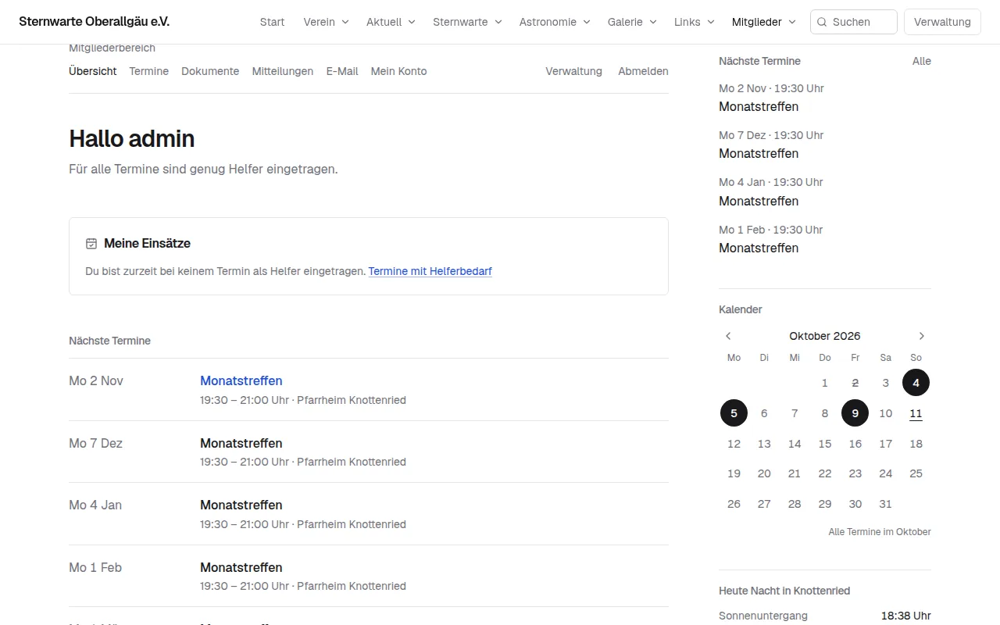
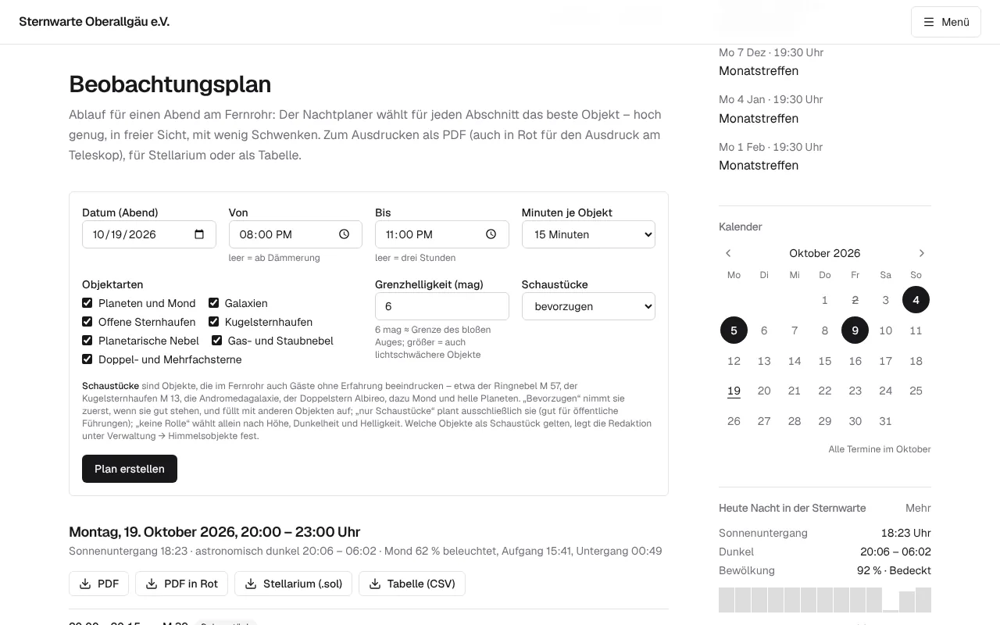
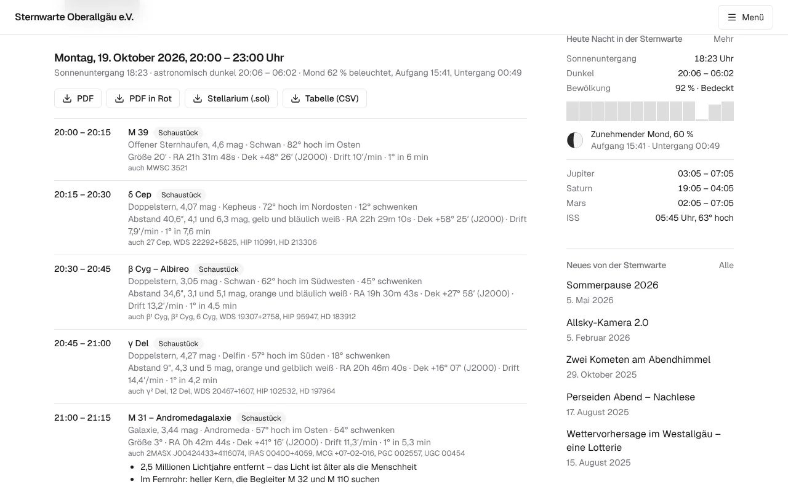
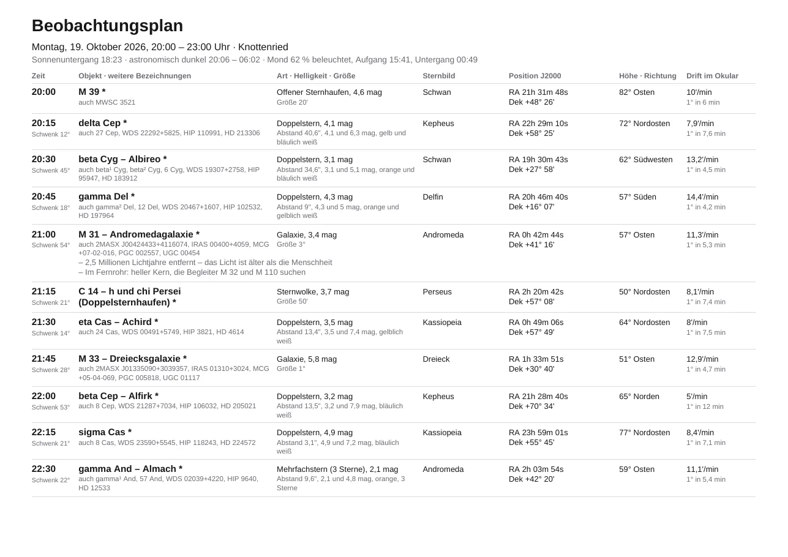
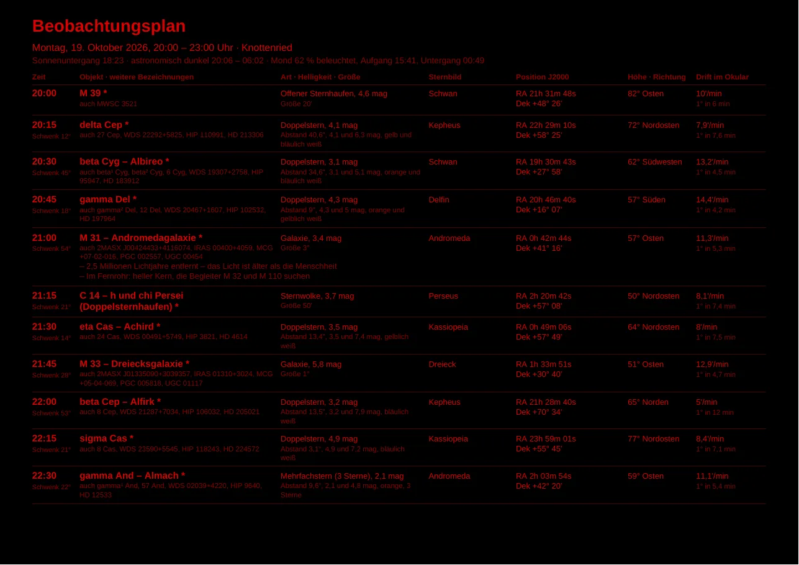
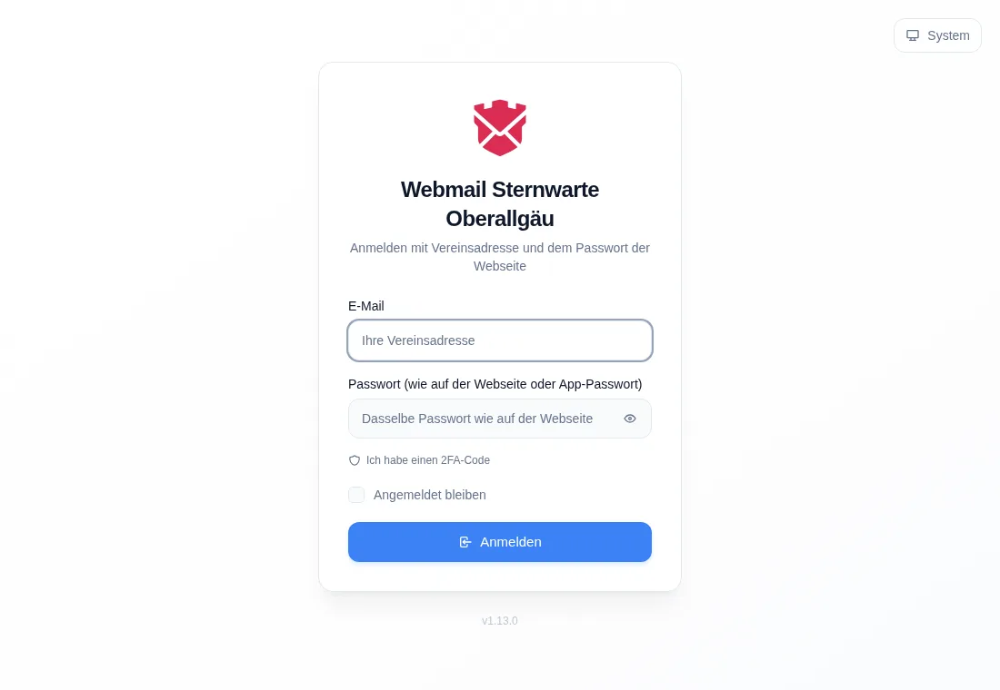
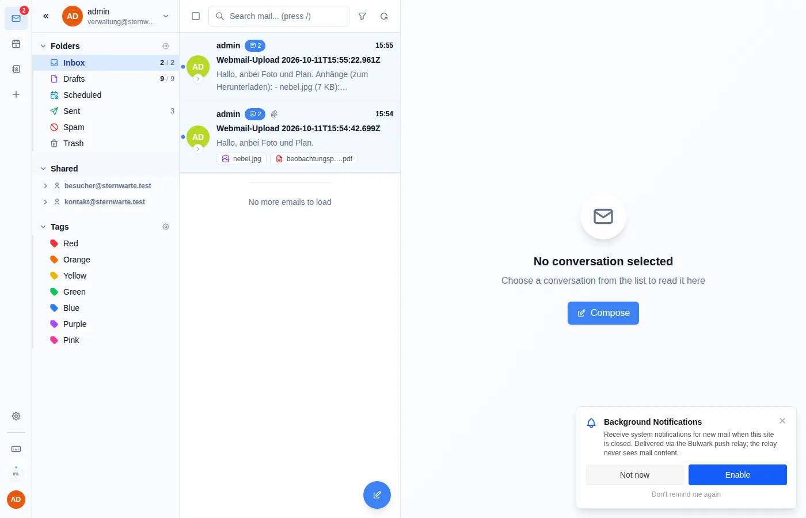
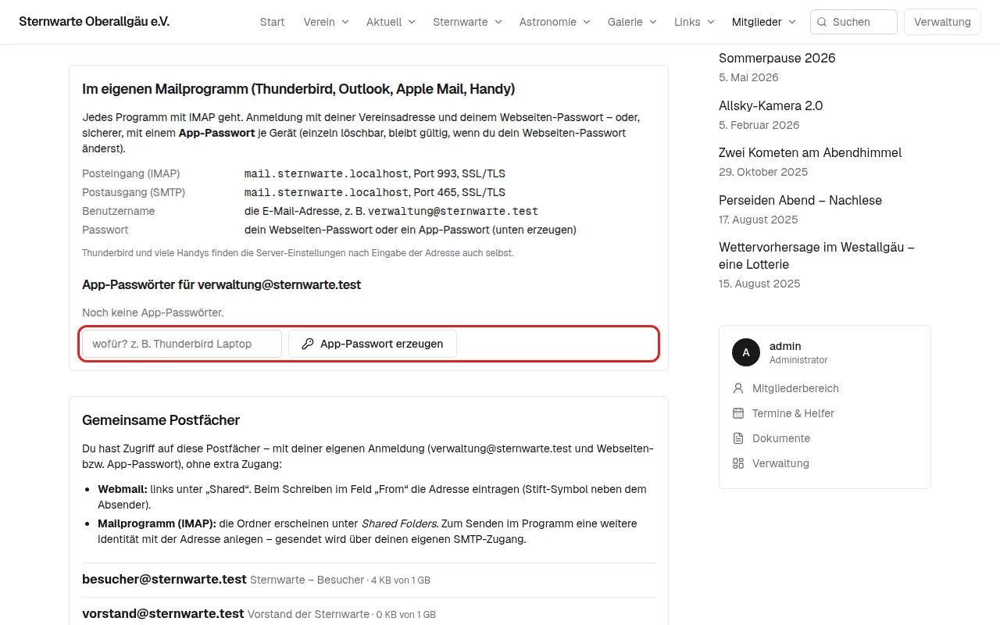
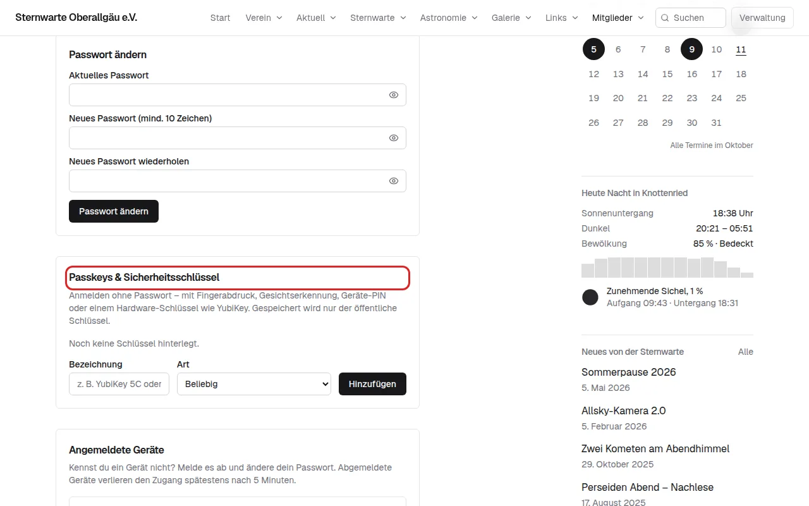

# Der Mitgliederbereich

Nach dem Anmelden erscheint im Hauptmenü der Punkt **„Mitglieder“**. Dort findest du alles, was nur für
Vereinsmitglieder gedacht ist.

| Bereich | Was du dort machst |
|---|---|
| **Übersicht** | deine Helfer-Einsätze, die nächsten Termine |
| **Termine** | interne und öffentliche Termine; bei Terminen mit Helferbedarf trägst du dich als Helfer ein (und wieder aus) |
| **Beobachtungsplan** | Ablauf für einen Abend am Fernrohr, zum Ausdrucken oder für Stellarium – siehe [unten](#beobachtungsplan) |
| **Dokumente** | Satzung, Protokolle, Pläne als PDF (nur lesen) |
| **Mitteilungen** | Neuigkeiten nur für Mitglieder |
| **E-Mail** | deine Vereins-E-Mail: Webmail, Zugang fürs Mailprogramm, gemeinsame Postfächer |
| **Mein Konto** | Name, Passwort, Passkeys, angemeldete Geräte |

Das Menü **„Mitglieder“** klappt auf und zeigt alle Bereiche auf einen Blick. Welche Punkte dort stehen, legt die
Redaktion in der Verwaltung fest.

## Beobachtungsplan

Ihr habt einen Beobachtungsabend oder eine Führung und wollt wissen: **Was zeigen wir wann?** Der Beobachtungsplan
stellt einen Ablauf zusammen – für jeden Abschnitt (z. B. 15 Minuten) das Objekt, das gerade am besten steht: hoch
genug, nicht hinter den Bäumen, möglichst dunkel und mit wenig Schwenken des Fernrohrs von einem Objekt zum nächsten.

Aufrufen: **Mitglieder → Beobachtungsplan**, oder unter **Termine** bei einem Termin auf
**„Beobachtungsplan für diesen Abend →“** – dann sind Datum und Uhrzeit schon eingetragen.

### Das Formular

| Feld | Was du einträgst |
|---|---|
| **Datum (Abend)** | der Abend, an dem beobachtet wird (bis zu 60 Tage im Voraus) |
| **Von / Bis** | Beginn und Ende. Leer lassen = ab Beginn der Dunkelheit, drei Stunden lang. Zeiten nach Mitternacht (z. B. 01:00) gehören zum Morgen danach |
| **Minuten je Objekt** | wie lange ihr bei einem Objekt bleibt (5 bis 60 Minuten). Bei Führungen mit vielen Gästen eher 15–20 |
| **Objektarten** | was in den Plan darf: Planeten und Mond, Galaxien, Sternhaufen, Nebel, **Doppel- und Mehrfachsterne** |
| **Grenzhelligkeit (mag)** | wie lichtschwach ein Objekt höchstens sein darf. **6 mag** (voreingestellt) ist die Grenze des bloßen Auges; mit einem größeren Fernrohr kannst du 8–10 eintragen |
| **Schaustücke** | siehe nächster Abschnitt |

Dann **„Plan erstellen“**. Kommt der Hinweis „Die Nacht wird berechnet …“, kurz warten – die Seite lädt sich von
selbst neu.

### Was sind Schaustücke?

**Schaustücke** sind Objekte, die im Fernrohr auch Gäste **ohne Erfahrung** beeindrucken: der Ringnebel M 57, der
Kugelsternhaufen M 13, die Andromedagalaxie, der farbige Doppelstern Albireo, Mond und helle Planeten. Ein blasser
Nebelfleck mag Kenner begeistern – Gäste sehen darin oft nichts.

| Auswahl | Was passiert | Gut für |
|---|---|---|
| **bevorzugen** (Standard) | Schaustücke kommen zuerst dran, wenn sie gut stehen; der Rest wird mit anderen Objekten aufgefüllt | die meisten Abende |
| **nur Schaustücke** | der Plan enthält ausschließlich Schaustücke | öffentliche Führungen |
| **keine Rolle** | gewählt wird nur nach Höhe, Dunkelheit und Helligkeit | Beobachtung unter Kennern |

Welche Objekte Schaustücke sind und was man Gästen dazu erzählen kann (**Erzählkarte**), legt die Redaktion fest
(siehe [Verwaltung → Himmelsobjekte pflegen](verwaltung.md#12-himmelsobjekte-pflegen)).

### Den Plan lesen

Je Abschnitt steht da:

- **Uhrzeit und Objekt** – „Schaustück“ markiert die Schaustücke.
- **Art, Helligkeit, Sternbild, Höhe und Richtung** – z. B. „82° hoch im Osten“. Dazu, wie weit das Fernrohr vom
  vorigen Objekt **geschwenkt** werden muss.
- **Größe** (bei Doppelsternen: **Abstand**, Helligkeit beider Sterne und ihre **Farben**).
- **Position J2000** (RA/Dek) – zum Einstellen an einer Montierung mit Teilkreisen oder Goto.
- **Drift** – wie schnell das Objekt ohne Nachführung durchs Okular wandert, z. B. „1° in 5 Minuten“. Je höher die
  Zahl, desto öfter musst du von Hand nachführen. Nahe am Himmelspol steht ein Objekt fast still.
- **„auch …“** – weitere Bezeichnungen (z. B. HIP- oder HD-Nummer) – praktisch, wenn die Steuerung des Teleskops
  den gebräuchlichen Namen nicht kennt.
- Bei Schaustücken die Stichpunkte der **Erzählkarte**.

### Ausdrucken und mitnehmen

Über dem Plan stehen vier Knöpfe:

| Knopf | Was du bekommst |
|---|---|
| **PDF** | Tabelle zum Ausdrucken (Querformat), mit Sternbild, J2000, Höhe, Richtung, Drift und Erzählkarten |
| **PDF in Rot** | dasselbe in **Rot auf Schwarz** – blendet am Teleskop nicht und schont die Dunkelanpassung der Augen |
| **Stellarium (.sol)** | Beobachtungsliste für das Planetariumsprogramm Stellarium |
| **Tabelle (CSV)** | zum Öffnen in Excel oder LibreOffice |

**In Stellarium laden** (ab Version 1.0): Stellarium öffnen → **Beobachtungslisten** (Tastenkürzel `Alt + B`) →
**„Importieren“** → die heruntergeladene `.sol`-Datei wählen. Die Liste erscheint mit allen Objekten; ein Doppelklick
zeigt das Objekt am Himmel von Stellarium.

## Vereins-E-Mail

Wenn du ein Vereinspostfach hast (z. B. `vorname.nachname@sternwarte-oberallgaeu.de`), gilt:

> **Das Passwort ist dasselbe wie auf der Webseite.** Änderst du dein Passwort auf der Webseite, gilt das neue
> automatisch auch für die E-Mail.

### Im Browser (Webmail)

Mitgliederbereich → **E-Mail** – das Webmail ist dort eingebettet. Oder direkt unter
`https://webmail.sternwarte-oberallgaeu.de`: Vereinsadresse und Webseiten-Passwort eingeben.

**Gemeinsame Postfächer** (z. B. `besucher@`, `vorstand@`), die dir zugewiesen sind, stehen links unter
**„Shared“**. Zum Schreiben als diese Adresse beim Verfassen neben „From“ auf das Stift-Symbol klicken und die
Adresse eintragen.

### Im Mailprogramm (Thunderbird, Outlook, Apple Mail, Handy)

Thunderbird und viele Handys finden die Einstellungen selbst, wenn du nur Adresse und Passwort eingibst. Sonst:

| | |
|---|---|
| Posteingang (IMAP) | `mail.sternwarte-oberallgaeu.de`, Port **993**, SSL/TLS |
| Postausgang (SMTP) | `mail.sternwarte-oberallgaeu.de`, Port **587**, STARTTLS – welche Ports gehen, steht im Mitgliederbereich → E-Mail (ist 465 freigeschaltet, steht dort auch Port **465**, SSL/TLS) |
| Benutzername | deine Vereinsadresse |
| Passwort | dein Webseiten-Passwort **oder** ein App-Passwort |

**App-Passwort** (empfohlen fürs Handy): Mitgliederbereich → E-Mail → bei „App-Passwörter“ eine Bezeichnung
eintippen (z. B. „Handy“) und **„App-Passwort erzeugen“**. Es wird nur einmal angezeigt – gleich ins Mailprogramm
kopieren. Geht ein Gerät verloren, löschst du nur dieses App-Passwort; alle anderen Geräte laufen weiter.

Gemeinsame Postfächer erscheinen im Mailprogramm unter **„Shared Folders“**. Zum Senden als `vorstand@` usw. im
Programm eine **weitere Identität** mit dieser Adresse anlegen – gesendet wird über deinen eigenen Zugang.

### Rundschreiben an `mitglieder@`

Mails an `mitglieder@…` gehen an alle Mitglieder. Ob sie in deinem Vereinspostfach oder an deiner privaten Adresse
ankommen, stellst du unter Mitgliederbereich → E-Mail um.

## Mein Konto

- **Passwort ändern** (mindestens 10 Zeichen).
- **Passkeys & Sicherheitsschlüssel:** Anmelden ohne Passwort mit Fingerabdruck, Gesichtserkennung, Geräte-PIN oder
  einem YubiKey. Bezeichnung eintippen, **„Hinzufügen“**, den Anweisungen des Geräts folgen.
- **Angemeldete Geräte:** ein unbekanntes Gerät hier abmelden – und dann das Passwort ändern.

