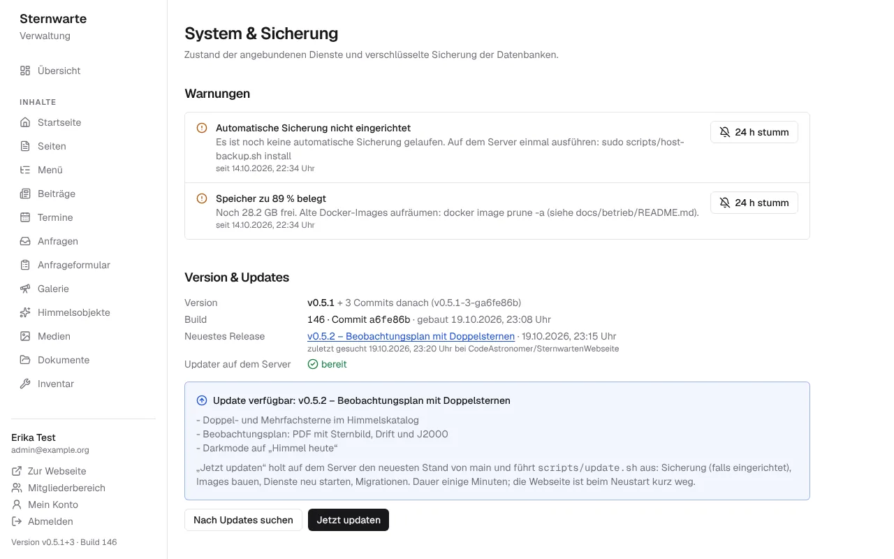

# Server einrichten, aktualisieren und Fehler beheben

Diese Anleitung ist zum **Abtippen** gedacht – Vorkenntnisse braucht es nicht. Befehle stehen in grauen Kästen:
kopieren, in das Terminal einfügen (Rechtsklick oder `Strg + Umschalt + V`) und mit **Enter** bestätigen.
Wörter in `<spitzen Klammern>` ersetzt du durch deine eigenen Angaben (ohne die Klammern).

> Für Technik-Interessierte gibt es die ausführliche Fassung unter [../betrieb](../betrieb/README.md).

**Inhalt**

- [A. Was du brauchst](#a-was-du-brauchst)
- [B. Mit dem Server verbinden](#b-mit-dem-server-verbinden)
- [C. Erstmalig einrichten](#c-erstmalig-einrichten)
- [D. Aktualisieren](#d-aktualisieren) – auch [über die Verwaltung](#updates-über-die-verwaltung)
- [E. Sicherungen](#e-sicherungen)
- [F. Wenn etwas nicht funktioniert](#f-wenn-etwas-nicht-funktioniert)
- [G. Kleines Wörterbuch](#g-kleines-wörterbuch)

---

## A. Was du brauchst

- Einen **Linux-Server** (z. B. Debian oder Ubuntu) mit Internetzugang. Zum Arbeitsspeicher, gemessen (siehe
  README): Bauen der Webseite braucht etwa 2,2 GB frei, pretix im Betrieb etwa 750 MB, die Webseite 150–250 MB –
  dazu kommen Datenbanken, Mailserver und CDN.
- Die **Domain** `sternwarte-oberallgaeu.de` bei **Cloudflare** (DNS dort verwaltet).
- Die **IP-Adresse** des Servers und das **root-Passwort** (bekommst du vom Anbieter per E-Mail).
- Zugang zum GitHub-Projekt `CodeAstronomer/SternwartenWebseite`.

## B. Mit dem Server verbinden

**Windows:** Startmenü → „PowerShell“ öffnen. **Mac:** Programme → Dienstprogramme → „Terminal“. Dann:

```bash
ssh root@<IP-Adresse>
```

Beim ersten Mal mit `yes` bestätigen, dann das Passwort eintippen (es erscheinen keine Zeichen – das ist normal).
Wenn vorne `root@…:~#` steht, bist du auf dem Server. **Beenden:** `exit`.

## C. Erstmalig einrichten

### 1. System aktualisieren und Werkzeuge installieren

```bash
apt update && apt upgrade -y
apt install -y git curl
curl -fsSL https://get.docker.com | sh
```

**Auslagerungsspeicher** (verhindert Abstürze beim Bauen, nur einmal):

```bash
fallocate -l 4G /swapfile && chmod 600 /swapfile && mkswap /swapfile && swapon /swapfile
echo '/swapfile none swap sw 0 0' >> /etc/fstab
```

**Firewall:** Eine Firewall auf dem Server selbst (`ufw`) bringt für die Dienste nichts – Docker öffnet seine
Ports daran vorbei. Was erreichbar sein soll, steht in [../betrieb/cloudflare.md](../betrieb/cloudflare.md).

### 2. Das Projekt holen

```bash
cd ~ && git clone https://github.com/CodeAstronomer/SternwartenWebseite.git && cd SternwartenWebseite
```

Fragt GitHub nach einem Passwort (privates Projekt): einen **Deploy-Key** anlegen –
`ssh-keygen -t ed25519 -N "" -f ~/.ssh/id_ed25519 && cat ~/.ssh/id_ed25519.pub` – die ausgegebene Zeile auf GitHub
unter *Settings → Deploy keys → Add deploy key* einfügen, dann mit
`git clone git@github.com:CodeAstronomer/SternwartenWebseite.git` klonen.

### Abkürzung: alles in einem Schritt

Das Installationsskript erledigt die Schritte 3, 5, 6 und 7 auf einmal – es legt die `.env` mit allen Passwörtern an,
baut und startet alles, spielt die Startdaten ein und lädt dich als Administrator ein:

```bash
./scripts/install.sh --domain sternwarte-oberallgaeu.de --seed yes \
  --admin_email <deine@email.de> --admin_username "<Vorname Nachname>" --admin_mailbox verwaltung
```

Am Ende stehen der Einladungslink und die nächsten Schritte auf dem Bildschirm. Alle Optionen und was das Skript
genau macht: [../installation.md](../installation.md). Schritt 4 (Cloudflare) bleibt von
Hand. Ohne Skript geht es so weiter:

### 3. Einstellungen (`.env`) anlegen

```bash
cp .env.example .env
nano .env
```

`nano` ist ein einfacher Texteditor: mit den Pfeiltasten bewegen, tippen wie gewohnt.
**Speichern:** `Strg + O`, dann Enter. **Beenden:** `Strg + X`.

Für Geheimnisse (Passwörter) brauchst du lange Zufallswerte. Diesen Befehl in einem **zweiten** Terminal-Fenster
mehrmals ausführen und jeweils eine Zeile kopieren:

```bash
openssl rand -hex 32
```

Mindestens diese Zeilen ausfüllen bzw. ändern:

| Zeile | Wert |
|---|---|
| `POSTGRES_PASSWORD=` | ein Zufallswert |
| `BETTER_AUTH_SECRET=` | ein Zufallswert |
| `BETTER_AUTH_URL=` | `https://www.sternwarte-oberallgaeu.de` |
| `COMPOSE_PROFILES=` | `pretix,mail,cdn` (oder nur was gebraucht wird) |

Für Ticketshop, E-Mail und CDN kommen weitere Zeilen dazu – die Vorlage erklärt jede Zeile, Details in
[../betrieb](../betrieb/README.md). **Wichtig:** Jede Zeile darf nur **einmal** in der Datei stehen.

### 4. Domain bei Cloudflare auf den Server leiten

Einen eigenen „Pförtner“ (Reverse Proxy) gibt es nicht – das übernimmt **Cloudflare**:

1. Für jede Adresse aus der `.env` (`BETTER_AUTH_URL`, und je nach Nutzung `PRETIX_URL`, `WEBMAIL_URL`,
   `MAIL_PUBLIC_URL`, `CDN_URL`, `CDN_DASHBOARD_URL`) bei Cloudflare einen DNS-Eintrag auf die IP des Servers anlegen,
   mit **oranger Wolke** (über Cloudflare).
2. Eine **Cloudflare-Regel** leitet diese Adresse auf den passenden **Port** des Servers (z. B. Webseite 6080).
3. In der `.env` für diese Dienste die Bindung auf `0.0.0.0` stellen (z. B. `WEB_BIND=0.0.0.0`) – sonst kommt
   Cloudflare nicht an den Port.

Welcher Dienst welchen Port hat und was dabei zu beachten ist: [../betrieb/cloudflare.md](../betrieb/cloudflare.md).
Die Einträge für die E-Mail (MX, SPF, DKIM …) zeigt später die Verwaltung unter **E-Mail → DNS-Einträge** an – sie
stehen bei Cloudflare auf **„nur DNS“** (graue Wolke).

### 5. Starten

```bash
docker compose up -d --build
```

Das erste Mal dauert es eine Weile (alles wird gebaut). Danach prüfen:

```bash
docker compose ps
```

Alle Zeilen sollten `Up` bzw. `healthy` zeigen (`tools`, `mail-setup` und `pretix-setup` stehen auf „Exited (0)“ –
das ist richtig, sie laufen nur kurz).

### 6. Inhalte und erstes Administrator-Konto

```bash
docker compose run --rm tools pnpm db:seed
docker compose run --rm tools pnpm admin:invite <deine@email.de> "<Vorname Nachname>"
```

Der zweite Befehl zeigt einen **Einladungslink** – im Browser öffnen und ein Passwort festlegen. Fertig: Die
Webseite läuft, die Verwaltung ist unter `/admin`.

### 7. Automatische Updates und Sicherungen einschalten

```bash
sudo scripts/host-backup.sh install
(crontab -l 2>/dev/null; echo '*/15 * * * * cd $HOME/SternwartenWebseite && ./scripts/server-update.sh >> update.log 2>&1') | crontab -
```

Und **unbedingt** den Sicherungs-Schlüssel ausgeben und im Passwort-Manager oder ausgedruckt im Vereinstresor
aufbewahren – ohne ihn lassen sich Sicherungen nicht mehr öffnen:

```bash
docker compose run --rm -e QUIET_START=1 tools cat /data/keys/backup.key
```

## D. Aktualisieren

Läuft der automatische Update-Auftrag aus Schritt 7, passiert das alle 15 Minuten von selbst. Von Hand:

```bash
cd ~/SternwartenWebseite
sudo ./scripts/update.sh
```

Das macht alles nötige in einem Rutsch: erst eine Sicherung, dann den neuen Stand holen, alles neu bauen, starten,
die Datenbanken umstellen und am Ende prüfen, ob die Webseite antwortet. Geht etwas schief, steht am Ende, mit
welchem Befehl es auf den vorigen Stand zurückgeht. Für den automatischen Auftrag alle 15 Minuten bleibt
`./scripts/server-update.sh` (baut nur, wenn sich etwas geändert hat).

Die Webseite bleibt während des Bauens online. Nach Änderungen an der `.env`:

```bash
docker compose up -d --force-recreate
```

### Updates über die Verwaltung

Damit Administratoren in der Verwaltung unter **System & Sicherung** auf **„Jetzt updaten“** drücken können, braucht
der Server einmal einen kleinen Helfer. Die Webseite selbst darf aus Sicherheitsgründen nichts auf dem Server
ändern – sie hinterlegt nur einen Auftrag, den der Helfer jede Minute abholt.



**1. In der `.env` prüfen** (`nano .env`, speichern mit `Strg + O`, `Enter`, beenden mit `Strg + X`):

```
UPDATE_REPOSITORY=CodeAstronomer/SternwartenWebseite
UPDATE_BRANCH=main
GITHUB_TOKEN=
```

- `UPDATE_BRANCH` – der Zweig, von dem Updates kommen. Fast immer `main`. Genau so schreiben, wie er auf GitHub heißt.
- `GITHUB_TOKEN` – nur nötig, wenn das Repository **privat** ist. Auf GitHub: Profilbild → **Settings → Developer
  settings → Personal access tokens → Fine-grained tokens → Generate new token**. Bei „Repository access“ nur dieses
  Repository wählen, bei „Permissions“ → **Contents: Read-only**. Mehr Rechte braucht es nicht.

> Den Token **nie** in einen Chat, eine E-Mail oder ins Repository kopieren. Ist das passiert: auf GitHub sofort
> löschen („Revoke“) und einen neuen anlegen.

Nach einer Änderung: `docker compose up -d --force-recreate web`.

**2. Den Helfer einrichten** (einmal):

```bash
cd ~/SternwartenWebseite
sudo scripts/host-update.sh install
```

Nach spätestens einer Minute steht in der Verwaltung bei „Updater auf dem Server“ **bereit**.

**3. Ein neues Release veröffentlichen** (wer am Quelltext arbeitet): auf GitHub → **Releases → Draft a new release**,
einen Tag wie `v1.3.0` anlegen, kurz beschreiben, was neu ist, **Publish release**. Die Verwaltung bietet das Update
dann an.

**Nachsehen, ob alles läuft:**

```bash
sudo scripts/host-update.sh status            # Helfer, letztes Lebenszeichen, Auftrag, Ergebnis, Verbindung zu GitHub
sudo scripts/host-update.sh run               # einen offenen Auftrag sofort ausführen und Fehler direkt sehen
sudo tail -f /var/log/sternwarte-update.log   # mitlesen (beenden mit Strg + C)
```

Der Helfer holt den neuen Stand **als Besitzer des Ordners** von GitHub (mit dessen Schlüssel), macht eine Sicherung
und ruft dann `scripts/update.sh` auf – dasselbe, als hättest du es von Hand eingetippt. Abschalten:
`sudo scripts/host-update.sh uninstall`.

## E. Sicherungen

- **Automatisch:** jede Nacht um 3:30 Uhr und alle 15 Minuten die Änderungen, abgelegt in `/var/backups/sternwarte`.
  Kontrolle: `ls -lt /var/backups/sternwarte/web/daily | head` – oben sollte das heutige oder gestrige Datum stehen.
- **Von Hand:** in der Verwaltung → System & Sicherung → „Komplette Sicherung“ herunterladen.
- **Zusätzlich** ab und zu eine Sicherung auf einen anderen Rechner kopieren (z. B. herunterladen und auf einer
  externen Festplatte ablegen).

**Zurückspielen** (überschreibt den aktuellen Stand – vorher überlegen!):

```bash
cd ~/SternwartenWebseite
cp /var/backups/sternwarte/web/daily/<Datum>.dump.enc . && chmod 644 <Datum>.dump.enc
docker compose run --rm -v "$PWD:/backup" tools pnpm backup:restore /backup/<Datum>.dump.enc
```

Für pretix bzw. E-Mail entsprechend den Ordner `pretix` bzw. `mail` nehmen und am Ende `--pretix` bzw. `--mail`
anhängen.

## F. Wenn etwas nicht funktioniert

Zuerst immer diese drei Schritte:

```bash
cd ~/SternwartenWebseite
docker compose ps
df -h /
```

1. Steht bei einem Dienst **nicht** `Up`/`healthy`? → dessen Protokoll ansehen: `docker compose logs --tail=100 <name>`
   (z. B. `web`, `pretix`, `stalwart`).
2. Ist die Festplatte voll (`Use%` bei 95–100 %)? → siehe unten „Festplatte voll“.
3. Hilft alles nicht: **neu starten** – `docker compose restart` (oder den ganzen Server: `reboot`, danach startet
   alles von selbst).

### Häufige Probleme

| Was du siehst | Was du tust |
|---|---|
| **Webseite gar nicht erreichbar** (Cloudflare-Seite „521“ oder „522“) | `docker compose ps` – läuft `web`? Wenn nein: `docker compose up -d`. Läuft er: steht `WEB_BIND=0.0.0.0` in der `.env`, und zeigt die Cloudflare-Regel auf den richtigen Port? |
| **„502 Bad Gateway“** | Die Webseite startet gerade (1–2 Minuten warten) oder ist abgestürzt: `docker compose logs --tail=100 web`. |
| **Anmelden geht nicht** („ungültig“) | Passwort vergessen? „Vergessen?“ auf der Anmeldeseite. Für alle Personen kaputt: Steht in der `.env` bei `BETTER_AUTH_URL` genau die Adresse aus dem Browser? Dann `docker compose up -d --force-recreate web`. |
| **Nach einem Update ist etwas kaputt** | Auf den vorigen Stand zurück: `git log --oneline -5` zeigt die letzten Stände; `git checkout <Nummer der vorletzten Zeile>` und `./scripts/server-update.sh --force`. Den automatischen Update-Auftrag solange anhalten: `crontab -e`, Zeile mit `#` am Anfang auskommentieren. Vorher mit `git branch --show-current` notieren, welcher Stand läuft (meist `main`) – später zurück mit `git checkout <dieser Name>`. |
| **Festplatte voll** | Alte Docker-Reste löschen: `docker system prune -f` (löscht **keine** Daten). Alte Sicherungen: `ls /var/backups/sternwarte/web/daily` und ältere Dateien mit `rm` entfernen. |
| **E-Mails kommen nicht an** | Verwaltung → E-Mail: steht „Mailserver – in Ordnung“? Dann „Einrichtung ausführen“ klicken. Landen sie im Spam: DNS-Einträge mit denen in der Verwaltung vergleichen. |
| **Ticketshop zeigt einen Fehler** | `docker compose logs --tail=100 pretix`; 2 Minuten nach einem Neustart ist pretix meist wieder da. |
| **Bilder fehlen** | Verwaltung → System: steht beim CDN „in Ordnung“? Sonst `docker compose up -d --force-recreate cdn web`. |
| **„Jetzt updaten“ passiert nichts** (Hinweis nach 3 Minuten) | `sudo scripts/host-update.sh status` – fehlt der Helfer: `sudo scripts/host-update.sh install`. Sonst `sudo scripts/host-update.sh run` zeigt den Fehler direkt. |
| **„Zweig … gibt es auf GitHub nicht“** | Tippfehler bei `UPDATE_BRANCH` in der `.env` (z. B. `feature` statt `features`). Korrigieren, in der Verwaltung „Erneut versuchen“. |
| **„Keine Verbindung zu GitHub“** oder **„Port 22 nicht erreichbar“** | Als Besitzer des Ordners (nicht mit `sudo`) testen: `ssh -T git@github.com`. Der Helfer versucht es von selbst auch über Port 443; klappt beides nicht, ist der Schlüssel nicht bei GitHub hinterlegt oder das Netz gesperrt. |
| **„detected dubious ownership“** | Kommt von einer alten Fassung. Einmal als Besitzer `git pull` im Ordner, danach läuft es über die Verwaltung. |
| **„Im Ordner sind Dateien geändert“** | `git status` zeigt welche. Eigene Änderungen sichern oder mit `git checkout -- <datei>` verwerfen. |
| **Besucher sehen nur „Wartungsarbeiten“** | Der Wartungsmodus ist an: Verwaltung → System & Sicherung → ganz unten „Wartungsmodus beenden“. |

### Hilfe von einer Fachperson holen

Mit diesem Befehl entsteht eine Datei mit den wichtigsten Protokollen. Passwörter schreibt die Webseite nicht ins
Protokoll – trotzdem vor dem Weitergeben kurz durchsehen:

```bash
cd ~/SternwartenWebseite
{ date; git log --oneline -3; docker compose ps; df -h /; free -h; docker compose logs --tail=200 web pretix stalwart cdn 2>&1; } > fehlerbericht.txt
```

Die Datei `fehlerbericht.txt` dann vom Server holen – auf deinem eigenen Rechner (nicht auf dem Server) ausführen:

```bash
scp root@<IP-Adresse>:SternwartenWebseite/fehlerbericht.txt .
```

Die `.env` bitte **nie** weitergeben oder irgendwo hochladen – darin stehen alle Passwörter.

## G. Kleines Wörterbuch

| Begriff | Bedeutung |
|---|---|
| **Server** | ein Computer im Rechenzentrum, auf dem die Webseite läuft |
| **Terminal / SSH** | ein Fenster, in dem man dem Server Befehle schreibt |
| **Docker / Container** | jedes Programm (Webseite, Datenbank, E-Mail …) läuft in seiner eigenen „Kiste“ |
| **`.env`** | die Datei mit allen Einstellungen und Passwörtern – gut hüten |
| **DNS** | das „Telefonbuch“ des Internets: welcher Name zu welcher IP-Adresse gehört |
| **Cloudflare** | steht vor der Webseite: macht HTTPS (das Schloss im Browser) und leitet jede Adresse auf den richtigen Port des Servers |
| **Sicherung / Backup** | eine Kopie aller Daten, verschlüsselt |
| **Wartungsmodus** | Besucher sehen nur einen Hinweis, Mitglieder und Verwaltung arbeiten weiter |
