# Die Verwaltung bedienen

Die Verwaltung erreichst du unter **`https://www.sternwarte-oberallgaeu.de/admin`** – oder auf der Webseite oben rechts
über **„Verwaltung“**, sobald du angemeldet bist. Die roten Rahmen in den Bildern zeigen, wo du klicken musst.

**Inhalt**

1. [Anmelden](#1-anmelden)
2. [Die Übersicht](#2-die-übersicht)
3. [Eine Seite bearbeiten](#3-eine-seite-bearbeiten)
4. [Einen Beitrag (Neuigkeit) schreiben](#4-einen-beitrag-neuigkeit-schreiben)
5. [Termine anlegen und absagen](#5-termine-anlegen-und-absagen)
6. [Anfragen für Sondertermine](#6-anfragen-für-sondertermine)
7. [Bilder und Dateien hochladen](#7-bilder-und-dateien-hochladen)
8. [Neue Personen einladen](#8-neue-personen-einladen) *(nur Administratoren)*
9. [Vereins-E-Mail-Adressen verwalten](#9-vereins-e-mail-adressen-verwalten) *(nur Administratoren)*
10. [Links prüfen](#10-links-prüfen)
11. [Sicherung und Wartungsmodus](#11-sicherung-und-wartungsmodus) *(nur Administratoren)*
12. [Himmelsobjekte pflegen](#12-himmelsobjekte-pflegen)
13. [Menü und versteckte Menüs](#13-menü-und-versteckte-menüs)
14. [Version und Updates](#14-version-und-updates) *(nur Administratoren)*

---

## 1. Anmelden

Gib deine E-Mail-Adresse und dein Passwort ein und klicke auf **„Anmelden“**. Hast du einen Passkey oder
Sicherheitsschlüssel (z. B. YubiKey) eingerichtet, geht es auch ohne Passwort.

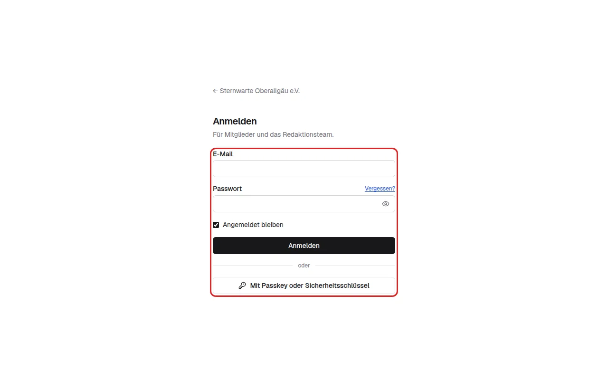

Passwort vergessen? Neben „Passwort“ auf **„Vergessen?“** klicken – du bekommst eine E-Mail mit einem Link.

## 2. Die Übersicht

Links ist das **Menü** mit allen Bereichen. Oben rechts gibt es Abkürzungen für das, was man am häufigsten
braucht: *Neuer Termin*, *Neuer Beitrag*, *Fotos hochladen*. Eine rote Zahl neben „Anfragen“ zeigt neue Anfragen.

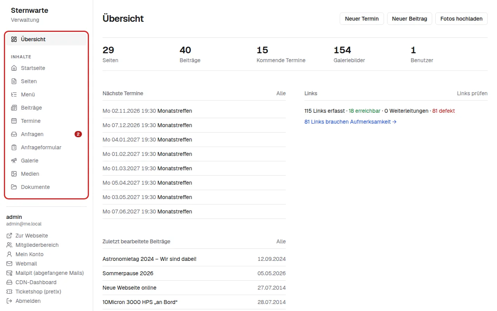

## 3. Eine Seite bearbeiten

1. Links auf **„Seiten“** klicken. Du siehst alle Seiten der Webseite.
   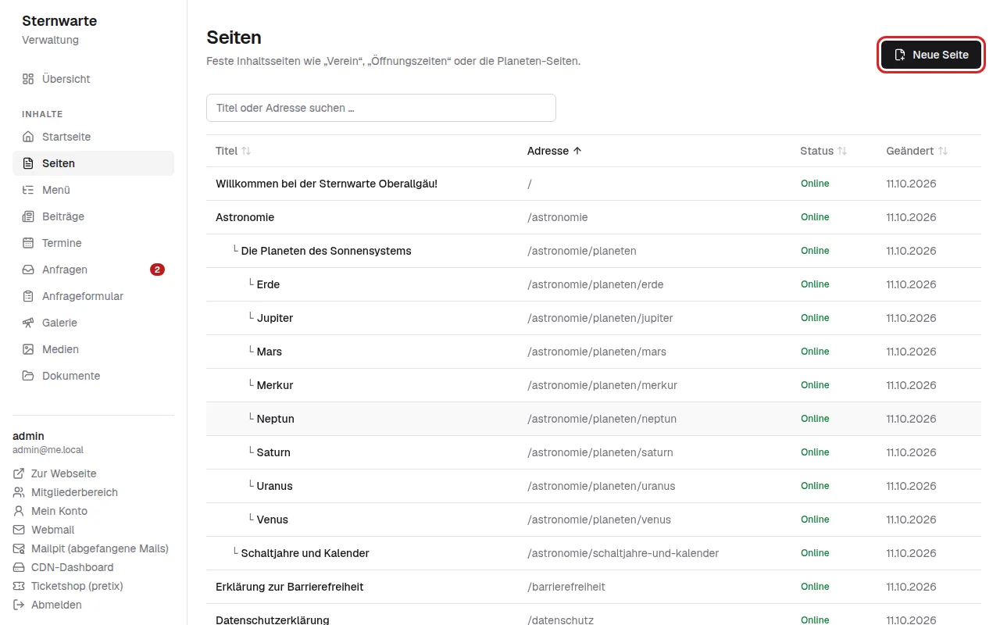
2. Die gewünschte Seite anklicken (oder **„Neue Seite“** für eine neue).
3. Den Text im großen Feld ändern – wie in einem Textprogramm. Die Knöpfe darüber machen **fett**, *kursiv*,
   Überschriften, Listen, Links, Bilder, Tabellen und Karten.
   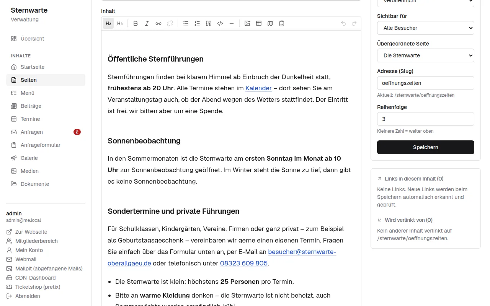
4. Rechts auf **„Speichern“** klicken. Die Änderung ist sofort auf der Webseite.

Tipps:
- **„Sichtbar für“** rechts: *Alle Besucher* oder nur *Mitglieder*.
- **Link einfügen:** Text markieren, auf das Ketten-Symbol klicken, Adresse eingeben.
- **Anfrageformular** einfügen: im Editor das Formular-Symbol – es erscheint dann an dieser Stelle der Seite.

## 4. Einen Beitrag (Neuigkeit) schreiben

Beiträge erscheinen unter „Aktuell“ und auf der Startseite.

1. **„Beiträge“** → **„Neuer Beitrag“** (oder oben in der Übersicht).
2. **Titel** eingeben, Text schreiben, rechts optional ein **Titelbild** und eine **Kategorie** wählen.
3. **„Speichern“**. Solange der Status *Entwurf* ist, erscheint er nicht auf der Webseite.

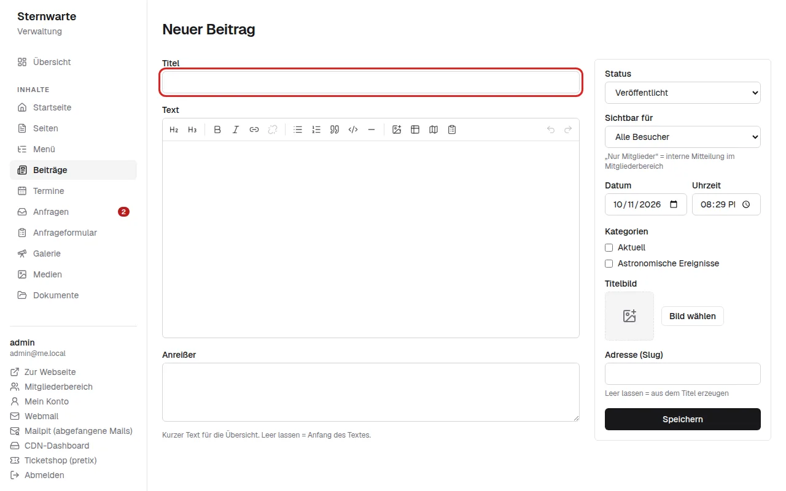

## 5. Termine anlegen und absagen

### Neuen Termin anlegen

1. **„Termine“** → **„Neuer Termin“**.
   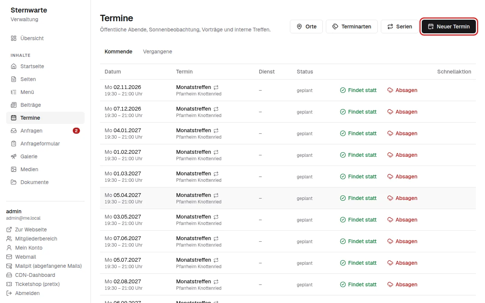
2. Oben eine **Terminart** wählen, z. B. „Öffentlicher Abend“. Uhrzeit, Ort, Beschreibung, Plätze und Ticketshop
   werden dann automatisch übernommen – meist musst du nur noch das **Datum** setzen.
   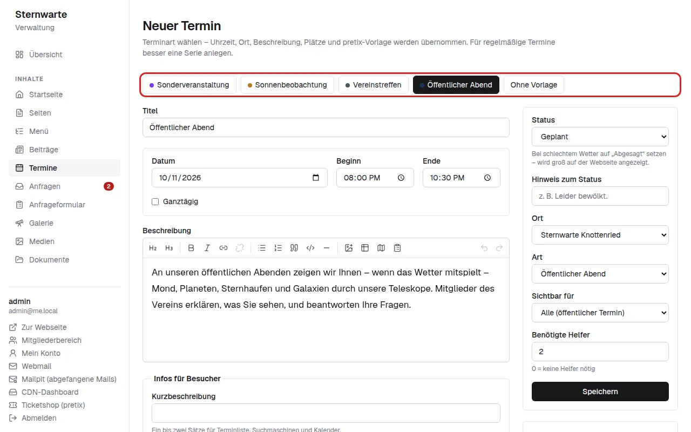
3. **„Speichern“**. Mit Ticketshop legt die Webseite den Vorverkauf selbst an.

Für regelmäßige Termine (z. B. „jeden ersten Montag“) gibt es oben **„Serien“**.

### Termin bei schlechtem Wetter absagen

Am schnellsten in der Terminliste: beim Termin auf **„Absagen“** klicken. Oder im Termin den **Status** auf
„Abgesagt“ stellen und optional einen **Hinweis** eintragen („Leider bewölkt“). Auf der Webseite erscheint die
Absage groß; gekaufte Tickets werden automatisch storniert und erstattet.

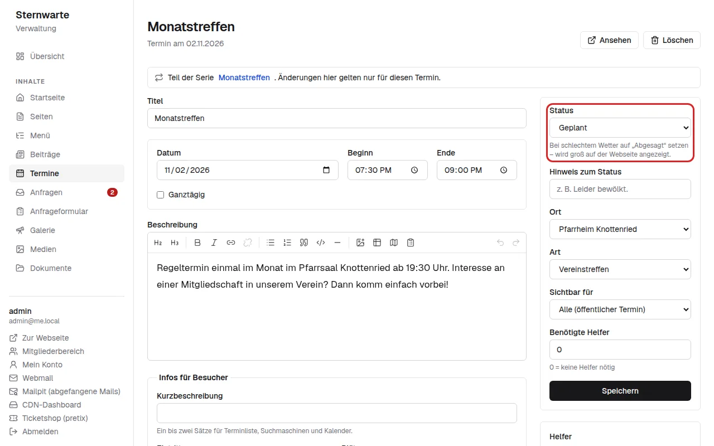

**„Findet statt“** bestätigt einen Termin (z. B. am Nachmittag, wenn das Wetter passt).

## 6. Anfragen für Sondertermine

Wer über das Formular „Sondertermin anfragen“ schreibt, landet hier (und bekommt eine Bestätigungs-Mail).

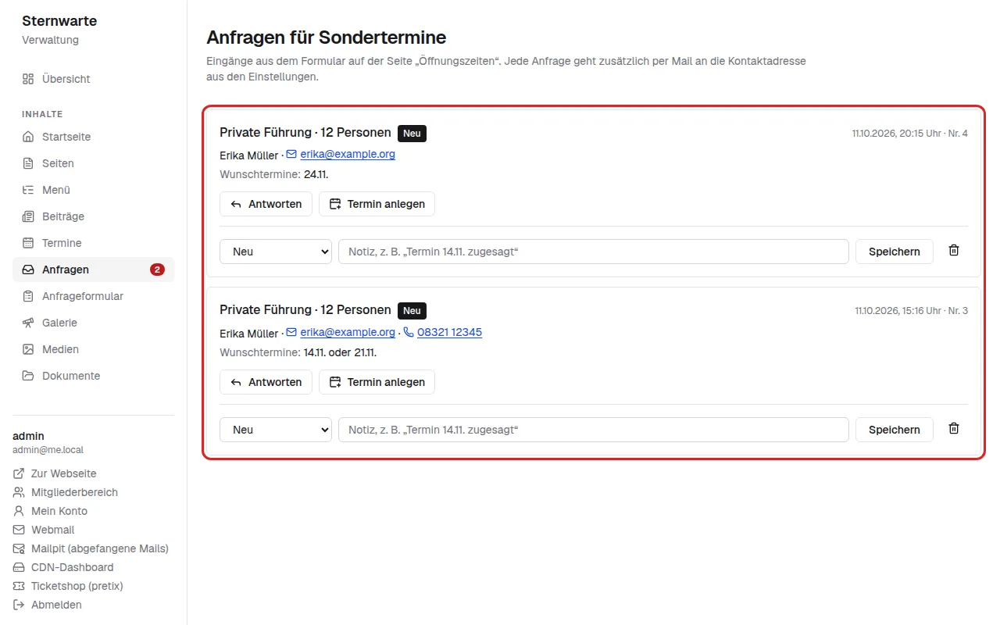

- **„Antworten“** öffnet dein Mailprogramm mit vorbereiteter Antwort.
- **„Termin anlegen“** erstellt einen Termin, der schon mit den Angaben der Anfrage ausgefüllt ist.
- Den **Status** (Neu, Beantwortet, Erledigt) und eine **Notiz** setzen, dann **„Speichern“** – so wissen alle,
  dass sich schon jemand kümmert.

Gut zu wissen: Wählt jemand einen Termin in der Woche um Vollmond, weist das Formular vorher darauf hin, dass
dann vor allem Mond und Planeten zu sehen sind, und schlägt einen dunkleren Abend vor.

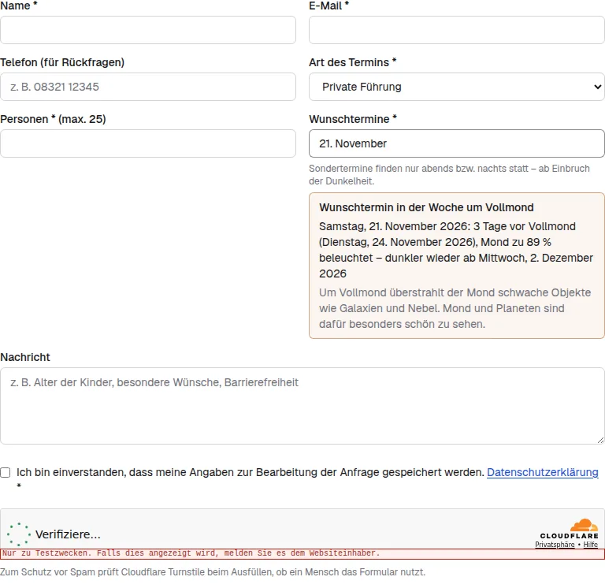

## 7. Bilder und Dateien hochladen

**„Medien“** → **„Hochladen“**: Im Reiter **„Dateien“** Bilder, PDFs und Videos auswählen (auch mehrere auf einmal).
Im Reiter **„Galerie (optional)“** lassen sich die Bilder gleich in die Galerie übernehmen: „Auch in die Galerie
aufnehmen“ anhaken, Album wählen (bei gewählter Objektart schlägt die Webseite das passende Album vor) und nach Bedarf
Titel, Beschreibung, Himmelsobjekte (z. B. `M 31, NGC 7000`) und Aufnahmedaten eintragen. Die Angaben gelten für alle
ausgewählten Dateien; leere Felder kommen aus den EXIF-Daten bzw. dem Dateinamen. Ein Klick auf eine Datei zeigt
Details: Alternativtext (für Blinde – bitte kurz beschreiben, was zu sehen ist) und wo sie verwendet wird.

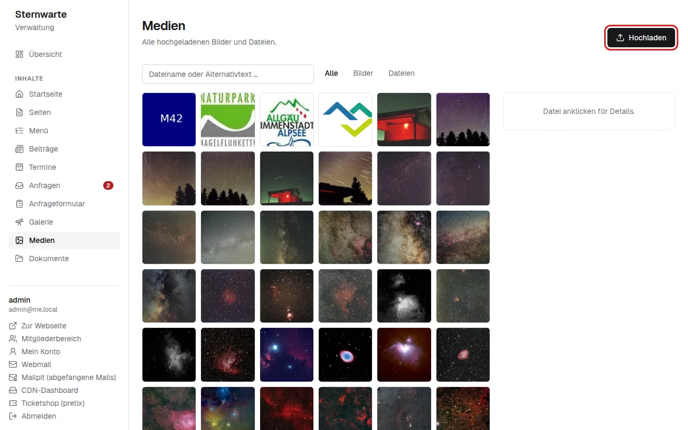

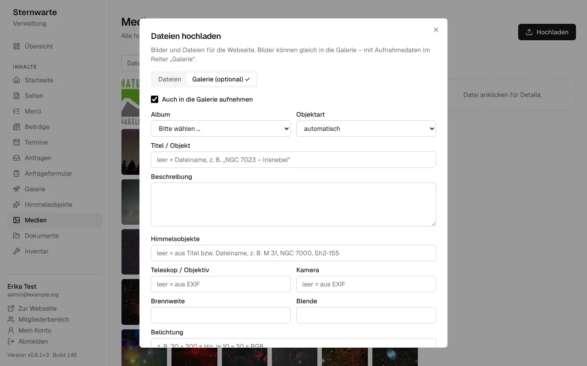

Für die **Galerie** (Astrofotos) gibt es den eigenen Bereich **„Galerie“** – dort werden Aufnahmedaten aus den Fotos
übernommen. Wer bei einem Bild die **Objektart** ändert (z. B. auf „Nebel“), verschiebt es damit ins passende Album;
wird gleichzeitig ein anderes Album gewählt, gilt das gewählte.

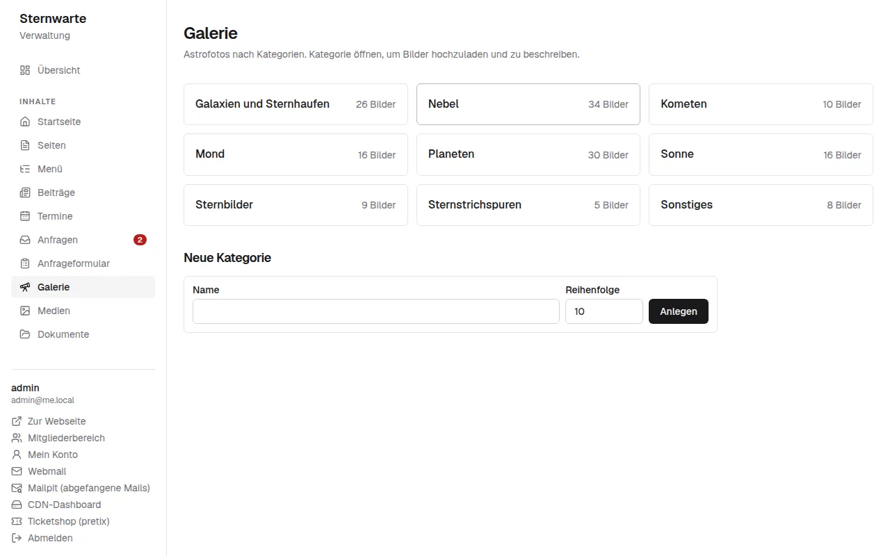

## 8. Neue Personen einladen

*(nur Administratoren)* **„Benutzer“** → oben **Name**, **E-Mail** und **Rolle** eintragen, optional
**„Vereinspostfach anlegen“** ankreuzen, dann **„Einladen“**. Die Person bekommt eine E-Mail mit einem Link und legt
dort selbst ihr Passwort fest.

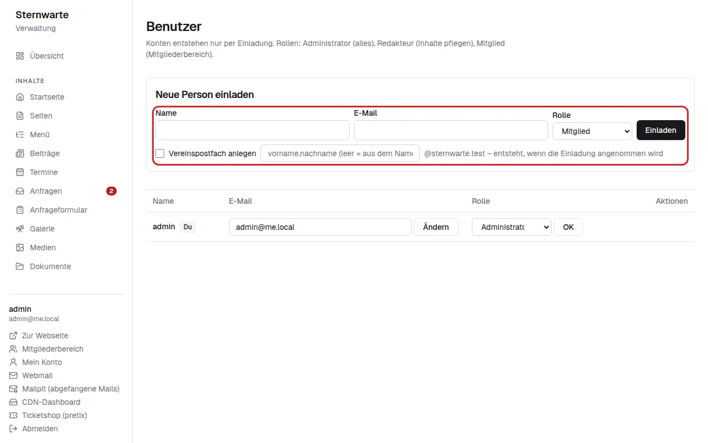

In der Liste darunter lässt sich die Rolle ändern; **„Passwort zurücksetzen“** schickt der Person eine E-Mail, mit der
sie ein neues Passwort vergibt.

## 9. Vereins-E-Mail-Adressen verwalten

*(nur Administratoren)* Bereich **„E-Mail“**.

### Funktionsadresse erstellen (z. B. kontakt@, vorstand@, besucher@)

Ganz oben unter **„Neue Funktionsadresse“**: Adresse und Absendername eingeben. **Zugriff** ist freiwillig – die
Adresse empfängt auch ohne Zuweisung Mails. Dann **„Adresse erstellen“**.

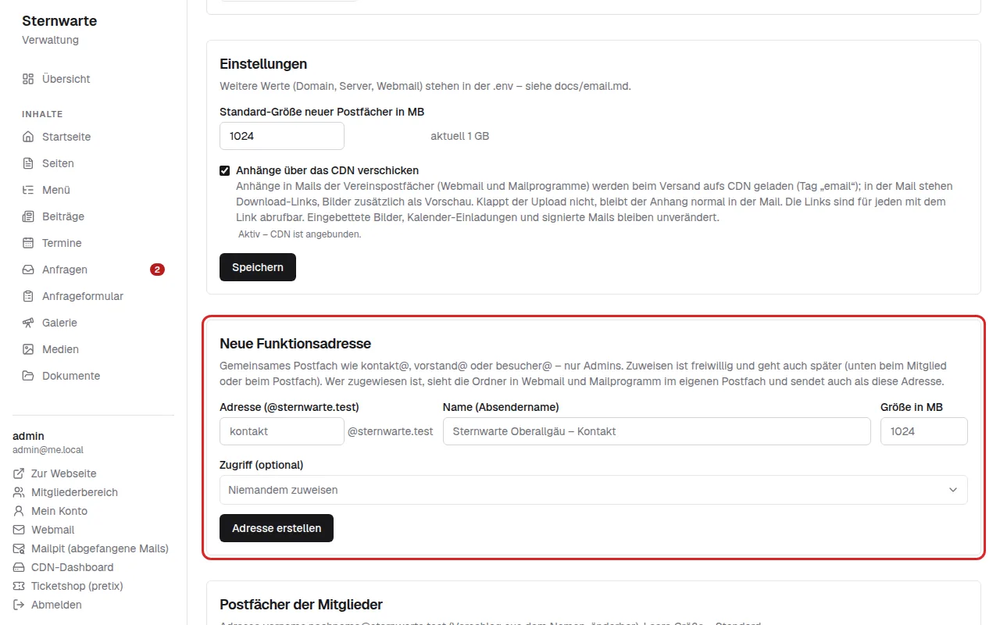

### Adressen Personen zuweisen

In der Tabelle **„Postfächer der Mitglieder“** gibt es die Spalte **„Gemeinsame Adressen“**: hineinklicken, eine
oder mehrere Adressen anhaken, **„OK“**. Die Person sieht diese Postfächer danach mit ihrer eigenen Anmeldung im
Webmail und im Mailprogramm und kann als diese Adresse schreiben. Mit dem **×** an einer Adresse nimmst du den
Zugriff wieder weg.

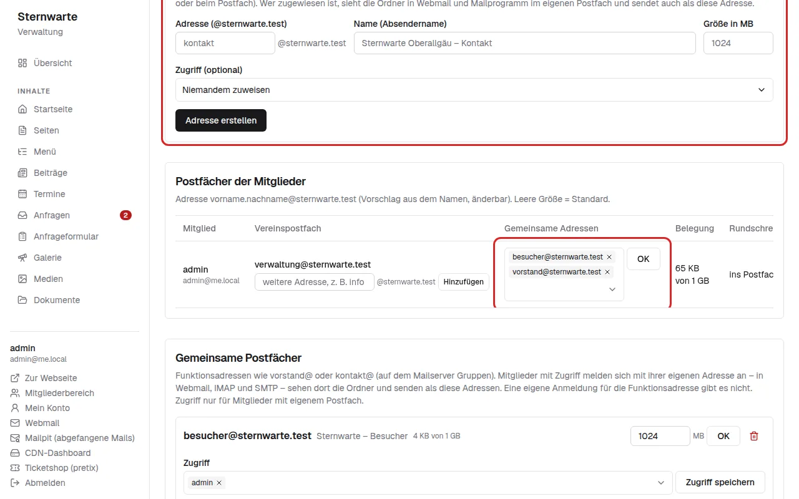

Andersherum geht es auch: weiter unten bei jedem gemeinsamen Postfach unter **„Zugriff“** mehrere Personen wählen.

## 10. Links prüfen

Die Webseite merkt sich jeden Link. **„Links prüfen“** ruft alle fremden Links ab und zeigt, welche **defekt** sind
oder **weitergeleitet** werden.

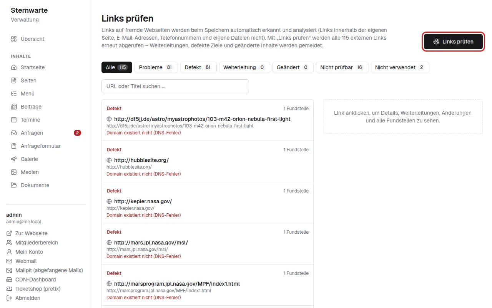

Einen Link anklicken: rechts stehen alle Stellen, an denen er vorkommt. Unter **„Link überall ersetzen“** die neue
Adresse eintragen und **„Ersetzen“** – er wird in allen Seiten, Beiträgen und Terminen auf einmal geändert. Der alte
Link verschwindet danach aus der Liste.

## 11. Sicherung und Wartungsmodus

*(nur Administratoren)* Bereich **„System & Sicherung“**.

**Sicherung herunterladen:** Bei jeder Datenbank **„Komplette Sicherung“** – die Datei ist verschlüsselt und nur mit
dem Schlüssel des Servers lesbar. Der Server sichert zusätzlich jede Nacht automatisch.

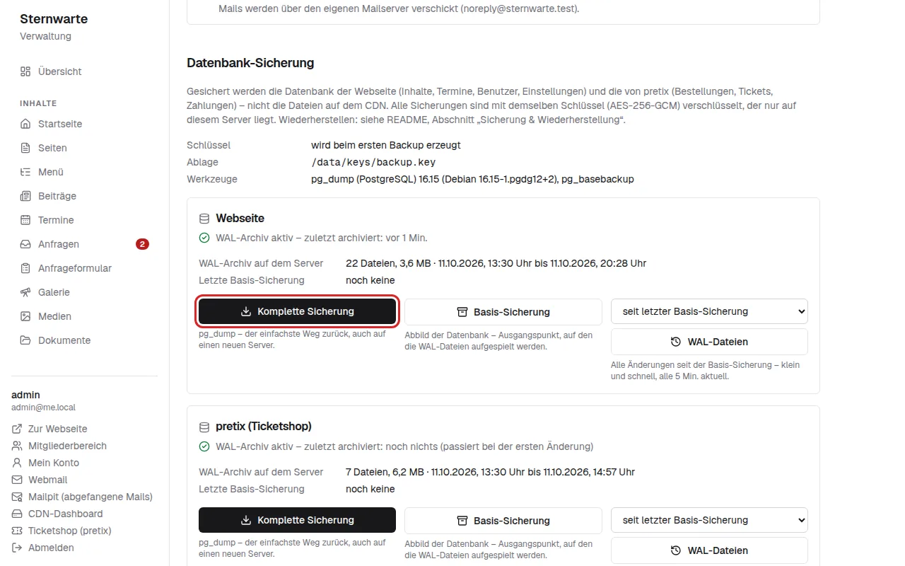

**Wartungsmodus:** Ganz unten in der **„Gefahrenzone“**. Während Arbeiten an der Webseite sehen Besucher dann nur
einen Hinweis („Wir arbeiten gerade an der Webseite“). Anmelden, Mitgliederbereich und Verwaltung funktionieren
weiter. Zum Einschalten das Wort **wartung** eintippen. Ausschalten an derselben Stelle.

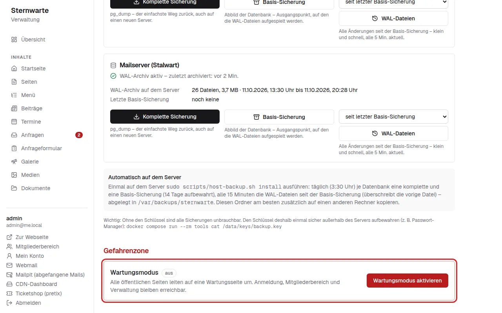

Im Bereich **„Einstellungen“** stehen u. a. Name und Untertitel der Webseite, Telefon, E-Mail und Adresse, der Ort
für die Himmels- und Wetteranzeige, das Spendenkonto, die Google Tabelle für den Mitgliederbereich und die
Unterstützer-Logos.

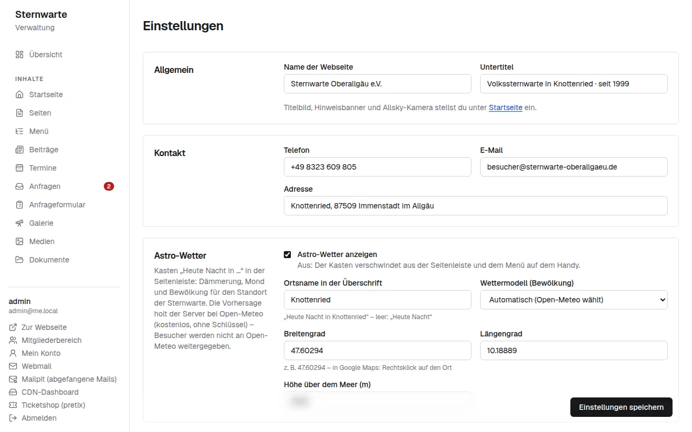

## 12. Himmelsobjekte pflegen

Jede Galaxie, jeder Nebel und Sternhaufen hat auf der Webseite eine eigene Seite unter **Himmelsobjekte** (siehe
[Anleitung Himmel](himmel.md)). Die Daten (Position, Helligkeit, Größe) kommen aus einem Katalog – du ergänzt, was
ein Katalog nicht weiß.

**„Himmelsobjekte“** in der Leiste links → oben suchen (`M 31`, `NGC 7000`, `Orion`) und einen Katalog wählen →
Objekt anklicken.

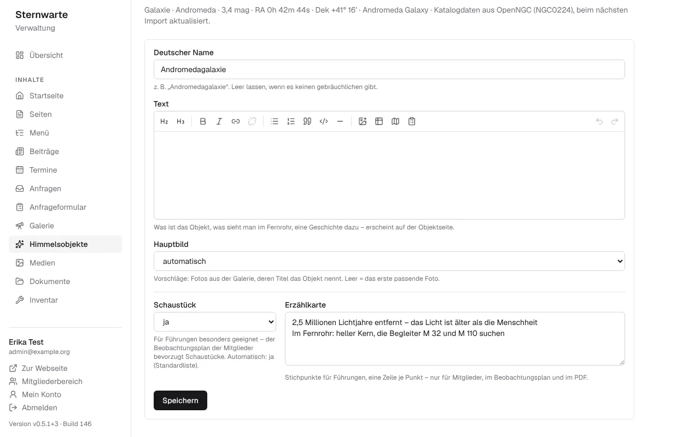

| Feld | Was du einträgst |
|---|---|
| **Deutscher Name** | z. B. „Andromedagalaxie“. Leer lassen, wenn es keinen gebräuchlichen gibt |
| **Text** | Was ist das Objekt, was sieht man im Fernrohr, eine Geschichte dazu – erscheint auf der Objektseite |
| **Hauptbild** | das große Foto oben auf der Objektseite. Vorgeschlagen werden Fotos aus der Galerie, die das Objekt zeigen. „automatisch“ = das erste passende Foto |
| **Schaustück** | **ja**, wenn das Objekt bei Führungen auch Gäste ohne Erfahrung beeindruckt. **automatisch** übernimmt eine eingebaute Liste (M 57, M 13, Albireo …). Der [Beobachtungsplan](mitglieder.md#beobachtungsplan) der Mitglieder nimmt Schaustücke bevorzugt |
| **Erzählkarte** | Stichpunkte für Führungen, **eine Zeile je Punkt** – z. B. „2,5 Millionen Lichtjahre entfernt“. Nur für Mitglieder: im Beobachtungsplan und im PDF |

Dann **„Speichern“**. Ein neuer Katalog-Import überschreibt diese Angaben nie.

**Fotos einem Objekt zuordnen:** In der **Galerie** bei einem Bild unter **„Himmelsobjekte“** die Messier- und
Caldwell-Objekte anklicken; weitere (NGC, IC, Sh2) mit Komma unter **„Weitere Objekte“** eintragen. Ohne Auswahl
erkennt die Webseite die Objekte aus Titel und Beschreibung (z. B. „M 31“ im Titel). Das Foto erscheint dann auf der
Objektseite. Beim **Hochladen** unter **Medien** geht das im Reiter **„Galerie (optional)“** gleich mit.

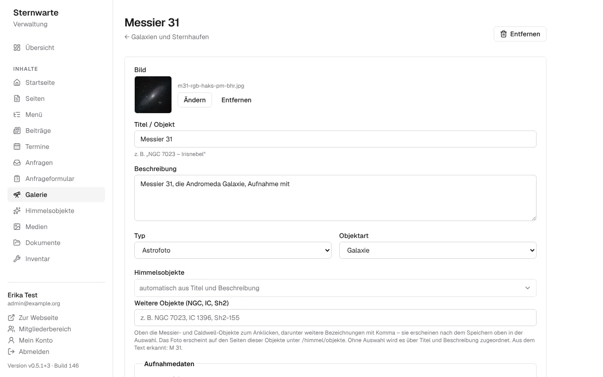

## 13. Menü und versteckte Menüs

**„Menü“** in der Leiste links. Oben stehen Reiter:

- **Hauptmenü** – das Menü oben auf der Webseite, das alle sehen.
- **Mitgliedermenü** (mit durchgestrichenem Auge) – der Punkt **„Mitglieder“**, den nur angemeldete Personen sehen.
  Seine Punkte bilden auch die Leiste oben im Mitgliederbereich.
- Weitere **versteckte Menüs**, z. B. „Redaktion“ – nur für bestimmte Rollen.

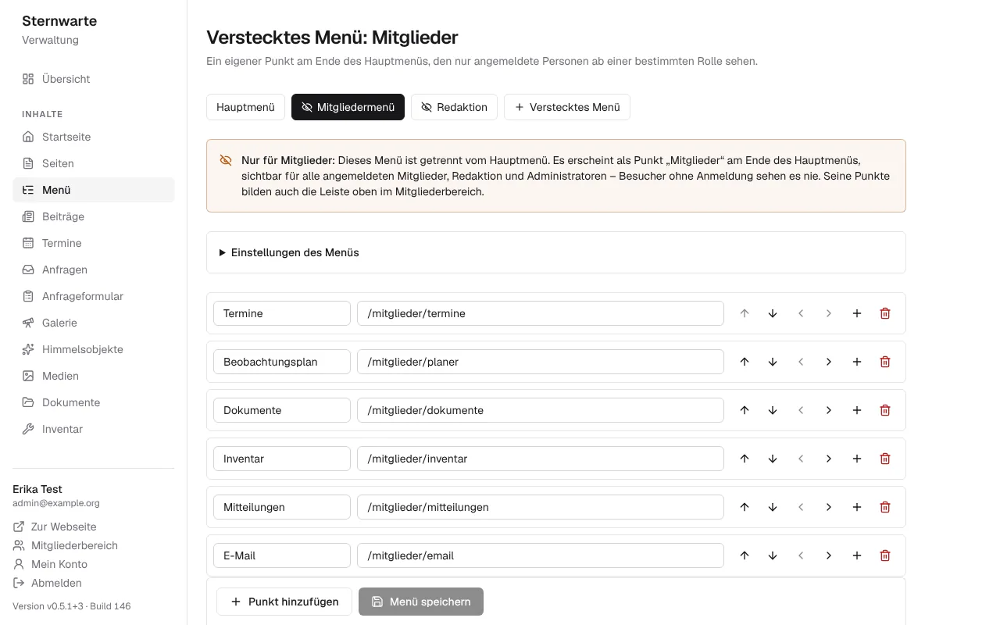

In jedem Reiter kannst du Punkte **hinzufügen** (Seite oder Adresse wählen), **umbenennen**, mit den Pfeilen
**verschieben**, **Unterpunkte** anlegen und **entfernen** – genau wie beim Hauptmenü. Beim Klick ins Feld für das
Ziel schlägt die Webseite passende Seiten vor, auch alle Seiten des Mitgliederbereichs (Termine, Beobachtungsplan,
Dokumente, E-Mail …).

So sieht das Mitgliedermenü dann auf der Webseite aus:

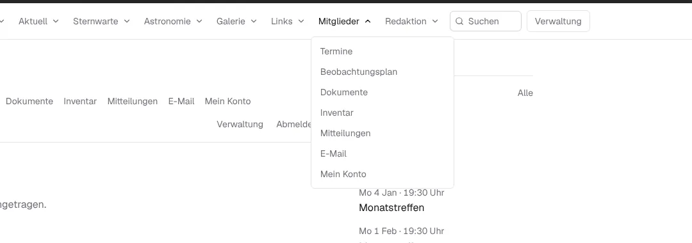

### Ein neues verstecktes Menü anlegen *(nur Administratoren)*

Reiter **„+ Verstecktes Menü“**:

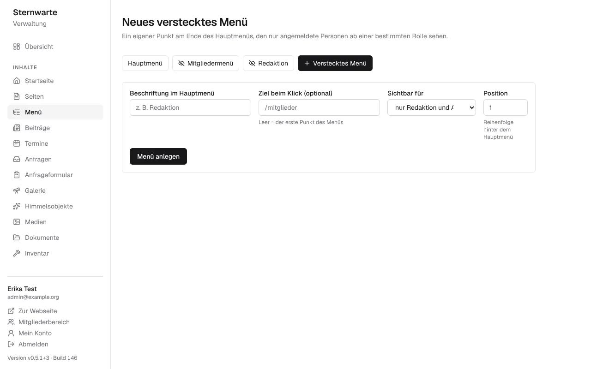

| Feld | Was du einträgst |
|---|---|
| **Beschriftung im Hauptmenü** | z. B. „Redaktion“ |
| **Ziel beim Klick** | optional – leer = der erste Punkt des Menüs |
| **Sichtbar für** | **Mitglieder** (alle Angemeldeten), **nur Redaktion und Admins** oder **nur Administratoren** |
| **Position** | Reihenfolge hinter dem Hauptmenü, wenn es mehrere gibt |

**„Menü anlegen“**, dann im neuen Reiter die Punkte hinzufügen. Unter **„Einstellungen des Menüs“** lässt sich das
später ändern oder das Menü löschen. Ein Menü „nur Administratoren“ sehen und bearbeiten auch in der Verwaltung nur
Administratoren. Das Mitgliedermenü selbst lässt sich nicht löschen.

> **Gut zu wissen:** Ein verstecktes Menü blendet nur die Links aus. Ob jemand eine Seite wirklich öffnen darf,
> prüft jede Seite selbst.

## 14. Version und Updates

*(nur Administratoren)* Bereich **„System & Sicherung“** → **„Version & Updates“**. Unten in der Leiste links steht
die Version auch immer, z. B. „Version v0.5.1+3 · Build 146“.

| Zeile | Bedeutung |
|---|---|
| **Version** | das laufende Release, z. B. `v0.5.1`. „+ 3 Commits danach“ heißt: drei kleine Änderungen nach diesem Release sind schon drin |
| **Build** | fortlaufende Nummer, Commit und wann gebaut wurde |
| **Neuestes Release** | das neueste Release auf GitHub und wann zuletzt nachgesehen wurde |
| **Updater auf dem Server** | **bereit** = der Server holt Updates ab. Steht dort etwas anderes, muss ihn die Person mit Server-Zugang einmal einrichten ([Anleitung Server](server.md#updates-über-die-verwaltung)) |

**So aktualisierst du die Webseite:**

1. **„Nach Updates suchen“** – die Webseite schaut bei GitHub nach (sonst tut sie das alle 6 Stunden von selbst).
2. Gibt es ein neues Release, erscheint ein blauer Kasten **„Update verfügbar“** mit den Neuerungen.
3. **„Jetzt updaten“** klicken und bestätigen.
4. Innerhalb einer Minute beginnt der Server. Ein **Balken** zeigt, wie weit das Update ist, darunter der aktuelle
   Schritt (Sicherung, Bauen, Starten …) und die letzten Zeilen des Protokolls.

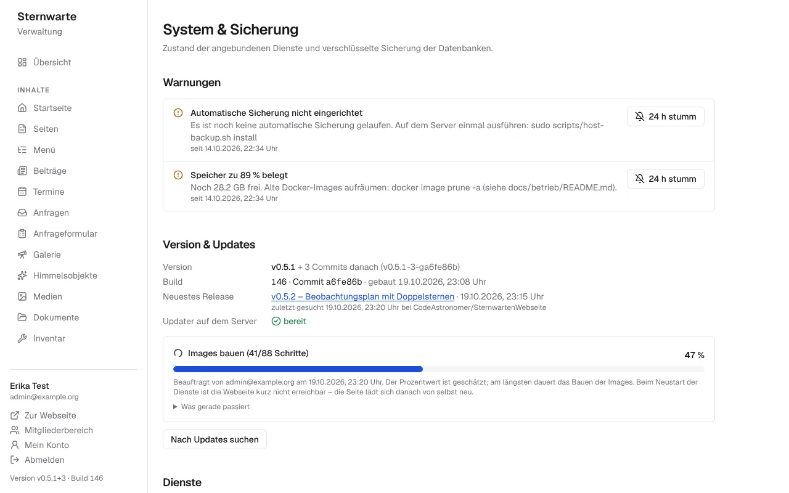

Ein Update dauert meist **2 bis 4 Minuten**. Vorher wird automatisch eine Sicherung gemacht. Gegen Ende ist die
Webseite einige Sekunden weg – die Seite wartet und lädt sich dann von selbst neu. Danach steht dort
**„Letztes Update: erfolgreich“** und die neue Version.

| Was du siehst | Was du tust |
|---|---|
| Hinweis „Der Server hat den Auftrag seit über 3 Minuten nicht begonnen“ | **„Auftrag zurücknehmen“** und der Person mit Server-Zugang Bescheid geben – der Updater läuft nicht |
| **„Letztes Update: fehlgeschlagen“** mit Protokoll | die Webseite läuft auf dem alten Stand weiter. Screenshot vom Protokoll machen, weitergeben; später **„Erneut versuchen“** |
| Kein Update angeboten, obwohl es ein Release gibt | „Nach Updates suchen“ – steht dort ein Fehler, an die Person mit Server-Zugang weitergeben |

Technische Einzelheiten: [Betrieb → Version und Updates](../betrieb/updates.md).
